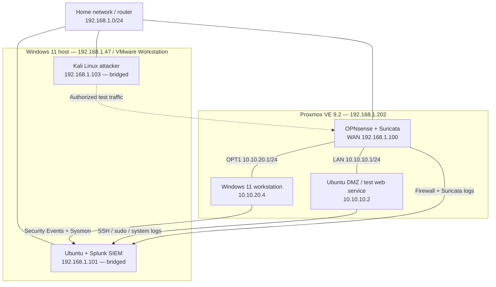
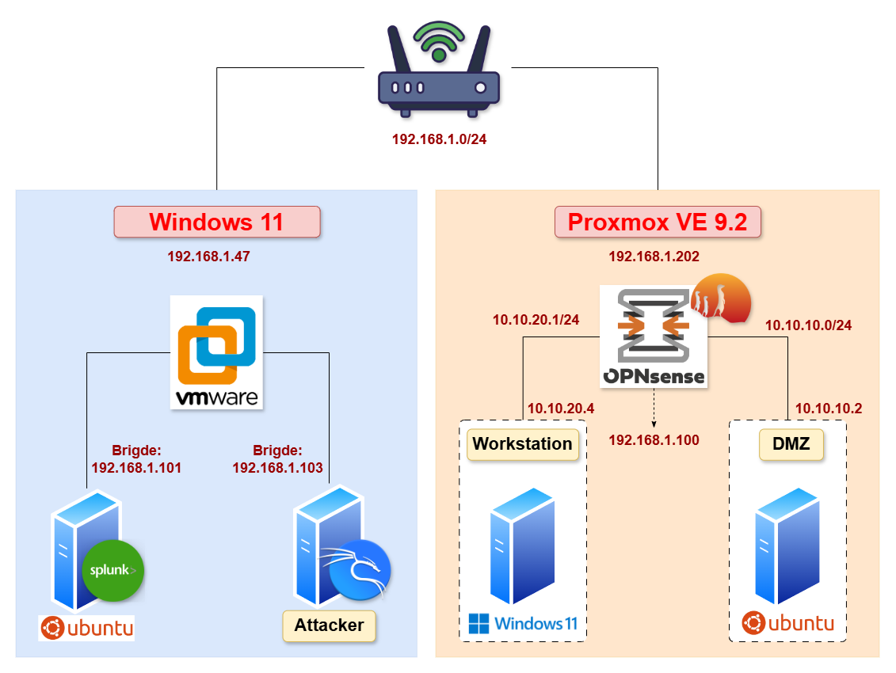
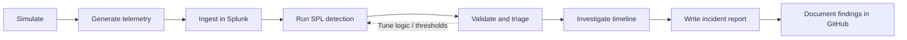

# SOC Homelab — Detection Engineering & Incident Investigation

**A reproducible, end-to-end SOC portfolio built with Splunk, Sysmon, OPNsense, Suricata, Windows 11, Ubuntu Server, and Kali Linux.**

This project demonstrates a practical Security Operations Center (SOC) workflow: collecting endpoint and network telemetry, engineering detections in Splunk Search Processing Language (SPL), safely simulating suspicious activity in a private lab, validating detections against raw events, and documenting investigations with evidence-backed incident reports.

> **Project status: In progress.** The homelab infrastructure and ingestion of Windows, Ubuntu, OPNsense firewall, and Suricata logs into Splunk are configured. The 12 detections, 8 scenarios, and 4 incident reports below are **planned deliverables**, not claimed completed or validated results. Progress and observed outcomes will be updated as work is performed.

## Project Goals

| Deliverable | Target | Acceptance criteria |
|---|---:|---|
| SPL detection rules | **12** | Query, detection logic, dependencies, test cases, and observed validation results |
| Simulated attack scenarios | **8** | Reproducible steps, expected vs. actual telemetry, evidence, and cleanup |
| Incident investigation reports | **4** | Executive summary, timeline, evidence, analysis, limitations, and recommendations |

**Primary skills:** Security monitoring · Detection engineering · Windows Event Logs · Sysmon · Linux authentication analysis · Firewall/IDS analysis · SPL · Alert triage · Incident investigation · MITRE ATT&CK mapping · Technical reporting.

## Lab Architecture





The Kali and Splunk virtual machines use **bridged networking** on the home LAN. The Windows workstation and Ubuntu DMZ are separate lab networks behind OPNsense. Cross-subnet test traffic requires working routing and appropriate firewall rules; the source address recorded in a log may differ when NAT is involved.

### Technology Stack

| Layer | Technology | Purpose |
|---|---|---|
| Virtualization | VMware Workstation; Proxmox VE 9.2 | Host the SIEM, attacker, firewall, and target VMs |
| SIEM | Splunk | Centralized event search, SPL detections, and investigation |
| Windows telemetry | Windows Security Event Logs; Sysmon | Authentication, account-management, and process execution visibility |
| Linux telemetry | Ubuntu Server 24.04 SSH / sudo logs | Authentication and privileged command visibility |
| Network security | OPNsense; Suricata | Firewall decisions and IDS alert telemetry |
| Simulation | Kali Linux; native OS utilities | Controlled behavior emulation inside the lab |
| Documentation | Markdown; GitHub | Reproducible procedures, evidence, and reports |

## SOC Workflow



A working SPL query is **not** automatically a validated detection. A detection is considered validated only after the corresponding positive test produces the expected telemetry, the query identifies it, and the result is backed by recorded evidence. Negative-control tests help identify obvious false positives; a small lab sample does not establish production detection accuracy.

## Detection Engineering — 12 SPL Rules

| ID | Detection | Primary telemetry | Initial priority | Scenario |
|---|---|---|---|---|
| DET-01 | Multiple Failed Windows Logons | Security Event ID `4625` | Medium | ATK-01 |
| DET-02 | Successful Windows Logon After Failures | Security `4625`, `4624` | High | ATK-02 |
| DET-03 | New Local User Account Created | Security `4720` | Medium | ATK-03 |
| DET-04 | User Added to Local Administrators | Security `4732` | High | ATK-03 |
| DET-05 | Encoded PowerShell Execution | Sysmon Event ID `1` | High | ATK-04 |
| DET-06 | Executable Launched from Temp Directory | Sysmon Event ID `1` | Medium | ATK-04 |
| DET-07 | Repeated SSH Authentication Failures | Ubuntu SSH logs | Medium | ATK-05 |
| DET-08 | Successful SSH Login After Failures | Ubuntu SSH logs | High | ATK-06 |
| DET-09 | Privileged Linux User Management | Ubuntu sudo / auth logs | High | ATK-06 |
| DET-10 | Possible Network Port Scanning | OPNsense firewall logs | Medium | ATK-07 |
| DET-11 | Suspicious HTTP Probe Alert | Suricata alerts | Medium | ATK-08 |
| DET-12 | Repeated IDS Alerts from One Source | Suricata alerts | High | ATK-08 |

Priorities and initial thresholds are **lab hypotheses**, to be adjusted after validation. Rule dependencies are recorded in `docs/data-sources.md` and `docs/detection-matrix.md` once those files are created.

Detection conventions:

- Save one query per file under `detections/windows/`, `detections/linux/`, or `detections/network/`.
- Record the **required index, sourcetype, extracted fields, time window, grouping keys, and threshold** for each rule.
- Correlate failed/successful authentication events by a matching identity and relevant context, rather than merely searching for both event IDs.
- For port-scan detection, count **distinct destination ports**, not only blocked-event volume.
- For Suricata, inspect whether alerts arrive as parsed EVE JSON or a different log format before referencing nested fields.
- Map to MITRE ATT&CK only where observed behavior and telemetry support the mapping.
- Record known false-positive causes and relevant exclusions; do not suppress unexplained alerts solely to obtain a passing result.

## Adversary Simulation — 8 Scenarios

All scenarios target **lab-owned systems only**, use non-destructive techniques, and require evidence collection and cleanup. These are behavior-emulation exercises, not a claim of real-world compromise.

| ID | Scenario | Lab target | Expected detections |
|---|---|---|---|
| ATK-01 | Repeated failed Windows sign-ins | Windows workstation `10.10.20.4` | DET-01 |
| ATK-02 | Valid Windows sign-in after failures | Windows workstation `10.10.20.4` | DET-02 |
| ATK-03 | Create local test user and add to Administrators | Windows workstation `10.10.20.4` | DET-03, DET-04 |
| ATK-04 | Benign encoded PowerShell and Temp executable | Windows workstation `10.10.20.4` | DET-05, DET-06 |
| ATK-05 | Controlled SSH password failures | Ubuntu DMZ `10.10.10.2` | DET-07 |
| ATK-06 | Valid SSH session and sudo user-management action | Ubuntu DMZ `10.10.10.2` | DET-08, DET-09 |
| ATK-07 | Low-rate TCP scan against a limited port range | Ubuntu DMZ through OPNsense | DET-10 |
| ATK-08 | Benign HTTP marker triggering a lab IDS signature | Ubuntu DMZ / Suricata | DET-11, DET-12 |

Each playbook in `scenarios/` should include the test objective, prerequisites, scoped source/target, simulation steps, expected events, SPL correlation, actual results, evidence references, and cleanup/rollback. Take snapshots where applicable; use test accounts; keep traffic constrained to the private lab.

### Traceability: Scenario → Detection → Report

| Investigation | Scenarios | Detections |
|---|---|---|
| IR-01 — Windows Credential Attack Investigation | ATK-01, ATK-02 | DET-01, DET-02 |
| IR-02 — Windows Account and Process Activity | ATK-03, ATK-04 | DET-03 through DET-06 |
| IR-03 — Linux SSH and Privileged Activity | ATK-05, ATK-06 | DET-07 through DET-09 |
| IR-04 — Network Reconnaissance and IDS Activity | ATK-07, ATK-08 | DET-10 through DET-12 |

This mapping is a **coverage plan**. It does not imply that two separate tests form one proven attacker sequence. Reports must distinguish observation, inference, and unverified hypotheses.

## Incident Reports — 4 Investigations

Planned reports in `incident-reports/`:

1. **IR-01 — Windows Credential Attack Investigation:** failed authentication, subsequent successful logon, identity/context correlation.
2. **IR-02 — Windows Account and Process Activity:** local account/group modification and suspicious process telemetry.
3. **IR-03 — Linux SSH and Privileged Activity:** SSH failures/success and subsequent sudo user-management operations.
4. **IR-04 — Network Reconnaissance and IDS Activity:** blocked/observed connections, port distribution, and Suricata alert context.

Every report will contain:

- Executive summary, incident scope, and analysis status.
- Relevant assets, account identities, and observed time window (timezone explicitly recorded).
- Initial detection and triage rationale.
- Chronological event timeline with source log references.
- SPL searches, event details, and sanitized screenshots/log extracts.
- Relevant MITRE ATT&CK technique mapping **when supported by evidence**.
- Assessment of impact, uncertainty, false positives, and investigation limitations.
- Containment/remediation considerations and detection-improvement recommendations.

**Reporting standard:** “Alert triggered,” “suspicious activity observed,” and “compromise confirmed” are different conclusions. A simulated scenario must not be documented as a real intrusion, and unexplained gaps should not be filled with invented evidence.

## Repository Structure

The following is the **intended structure**; files and folders will be added as each deliverable is completed.

```text
soc-homelab-detection-engineering/
├── README.md
├── docs/
│   ├── data-sources.md
│   ├── detection-matrix.md
│   ├── validation-results.md
│   └── lab-architecture.png              # optional topology screenshot
├── detections/
│   ├── windows/                       # DET-01 ... DET-06
│   ├── linux/                         # DET-07 ... DET-09
│   └── network/                       # DET-10 ... DET-12
├── scenarios/
│   ├── ATK-01.md
│   ├── ATK-02.md
│   ├── ATK-03.md
│   ├── ATK-04.md
│   ├── ATK-05.md
│   ├── ATK-06.md
│   ├── ATK-07.md
│   └── ATK-08.md
├── incident-reports/
│   ├── IR-01.md
│   ├── IR-02.md
│   ├── IR-03.md
│   └── IR-04.md
├── evidence/
│   ├── windows/
│   ├── linux/
│   └── network/
└── splunk/
    └── savedsearches.conf               # optional sanitized export
```

## How to Reproduce the Validation

> This README describes the test methodology. Reproducing detections requires the actual `.spl` and scenario playbook files as they are published.

1. **Provision the lab:** Windows workstation and Ubuntu DMZ behind OPNsense, with Kali as a separately controlled test machine and Splunk reachable for log forwarding.
2. **Confirm telemetry:** Verify Windows Security IDs `4624`, `4625`, `4720`, `4732`; Sysmon `1`; Linux SSH/sudo; OPNsense firewall; Suricata alert events. Verify host clock synchronization.
3. **Document field mappings:** Determine the *actual* `index`, `sourcetype`, `host`, event ID, user, IP, port, and nested alert field names used by your Splunk deployment. Do not paste placeholder searches unchanged.
4. **Run positive tests:** Follow `scenarios/ATK-XX.md`, record start/end times, query the corresponding events in Splunk, and execute related DET-XX searches.
5. **Run negative controls:** Test representative benign activity or a below-threshold event sequence. Record unexpected alerting and possible tuning changes.
6. **Capture evidence:** Preserve sanitized event excerpts, search results, timestamps, and the specific SPL version used.
7. **Investigate:** Build a timeline and complete the relevant `incident-reports/IR-XX.md` without adding unsupported claims.
8. **Clean up:** Remove temporary test users/files, revert temporary configuration changes, and re-check the lab state.

Useful initial Splunk inventory search:

```spl
index=*
| stats count as events by index sourcetype host
| sort - events
```

Restrict subsequent searches to known indexes/sourcetypes for efficiency and more reproducible results. Splunk scheduled alerts, if used, depend on license/features and the local configuration; a saved SPL search alone does not prove an alerting workflow has executed.

### Evidence and Validation Criteria

Suggested fields for each test execution record:

| Field | What to record |
|---|---|
| Scenario / detection IDs | Example: `ATK-07` / `DET-10` |
| Test time | Start/end in ISO 8601 with timezone |
| Source and destination | IPs/hosts **as observed**, considering NAT |
| Input telemetry | Actual index, sourcetype, event IDs, and log sample IDs |
| Detection output | Result count, important fields, and SPL revision |
| Positive test | Pass / Fail / Partial / Blocked |
| Negative control | Pass / Fail / Not run |
| Interpretation | What the logs support and what remains unknown |
| Evidence location | Relative repository paths to sanitized artifacts |

**Status definitions:** `Draft` = rule written, not validated; `Pass` = positive test and evidence agree with expected behavior; `Partial` = some expected telemetry/detection is missing; `Fail` = execution completed but expected behavior was not detected; `Blocked` = prerequisite missing or test cannot run. A negative-control failure should also be recorded independently.

## Three-Day Delivery Plan

| Day | Focus | Expected output |
|---|---|---|
| **Day 1 — Detection Engineering** | Inventory telemetry, normalize fields, implement the 12 SPL rules, document assumptions | Detection source files and rule specifications |
| **Day 2 — Simulation & Validation** | Execute 8 controlled scenarios, correlate log evidence, tune rules, run negative controls | Scenario records, sanitized evidence, validation matrix |
| **Day 3 — Investigation & Publication** | Write 4 evidence-backed reports, check traceability, audit GitHub contents | Incident reports and completed portfolio |

Detailed working plan: `SOC_Homelab_3_Day_Project_Plan.md` (include this file in the repository if publishing the companion plan).

## Progress Tracker

- [x] Build the Windows / Proxmox / OPNsense homelab topology.
- [x] Configure Splunk ingestion for Windows, Ubuntu DMZ, firewall logs, and Suricata logs.
- [ ] Verify required event IDs, Sysmon coverage, parsing, and source field mappings.
- [ ] Implement and validate all **12** SPL detection rules.
- [ ] Execute and document all **8** controlled scenarios.
- [ ] Complete all **4** incident investigation reports.
- [ ] Publish sanitized evidence and final validation results.
- [ ] Perform final README/repository quality review.

## Limitations

- This is a small, intentionally controlled environment. Observed performance and false-positive behavior **cannot be generalized** to enterprise networks without further testing.
- Detection visibility depends on audit configuration, event forwarding, parsers, firewall policies, IDS inspection point, and time synchronization.
- Firewall block events do not necessarily represent all attempted or completed connections. IDS visibility also depends on which packets reach the monitored interface.
- Initial thresholds, priorities, and ATT&CK mappings are provisional pending evidence-based review.
- Authentication and user-management events in independently executed scenarios do not automatically establish a single intrusion chain.

## Safety and Data Handling

This repository is intended for **authorized training, detection validation, and defensive research**. Tests must remain within lab-owned assets. Do not publish passwords, tokens, private keys, personal information, full sensitive logs, or unredacted configurations. Use synthetic identities, sanitize screenshots/event excerpts, and document any important effects of redaction on evidence interpretation.

## Future Improvements

Potential extensions **outside the three-day scope**: structured ATT&CK coverage tracking, Splunk dashboards, alert automation/SOAR, additional Windows/Linux telemetry, improved false-positive evaluations, and adversary emulation against a more diverse set of endpoints.

---

**Purpose:** Demonstrate the complete SOC analyst loop — **observe → detect → validate → investigate → report** — with reproducible evidence rather than unverified claims of detection coverage.
